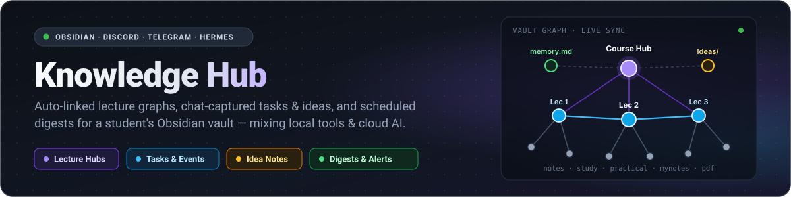
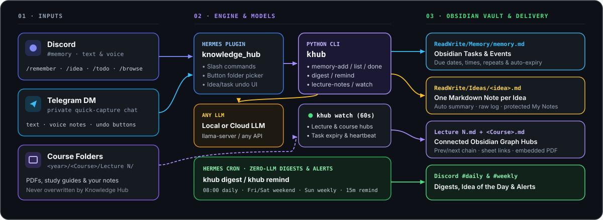
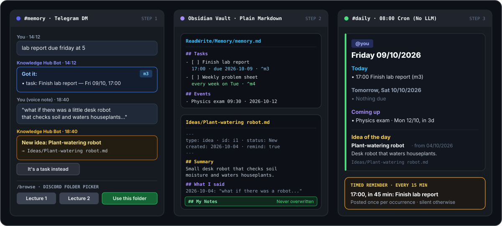
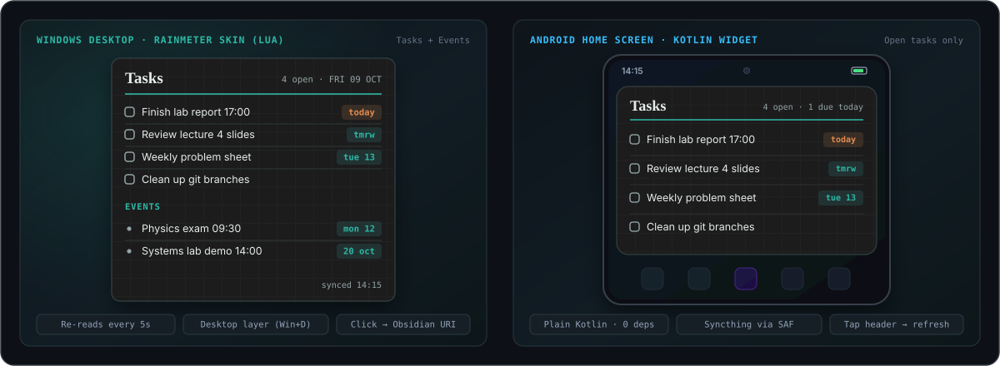
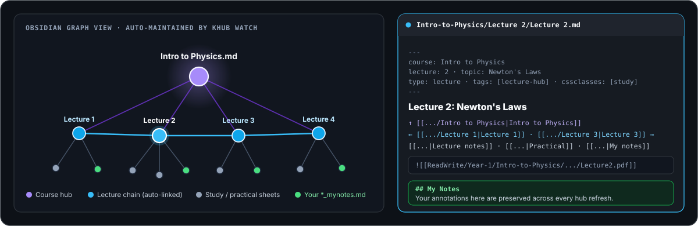

<p align="center">
  
</p>

<p align="center">
  <a href="https://github.com/MaximSyomushkin/knowledge-hub/actions/workflows/ci.yml"></a>
  
  
  
  
</p>

<p align="center">
  <a href="#features">Features</a> ·
  <a href="#architecture">Architecture</a> ·
  <a href="#workflow">Workflow</a> ·
  <a href="#widgets">Widgets</a> ·
  <a href="#lecture-graph">Lecture Graph</a> ·
  <a href="#quick-start">Quick Start</a> ·
  <a href="#commands">Commands</a> ·
  <a href="#project-layout">Layout</a>
</p>

---

**Knowledge Hub** (`khub`) is a Python CLI, [Hermes Agent](https://github.com/NousResearch/hermes-agent) plugin, and companion widget set for a student's **Obsidian** vault. Drop lecture PDFs into folders and they stay linked into a clean course graph; send a quick message or voice note on Discord or Telegram and it lands in `memory.md` or `Ideas/` as plain Markdown; get scheduled digests and timed reminders without running an LLM on every tick.

> [!NOTE]
> `khub` never modifies your lecture notes, slides, `*_mynotes.md`, or anything under a `## My Notes` heading. All data stays in plain Markdown files you can edit directly in Obsidian.

---

## Features

- **Lecture & course hubs** — scans your course folders and maintains `Lecture N.md` (prev/next links, study sheets, embedded PDF) plus `<Course>.md` so every module shows up as a clean chain in Obsidian's graph.
- **Chat & voice capture** — turns natural-language messages in Discord `#memory` or a Telegram DM into [Obsidian Tasks](https://publish.obsidian.md/tasks/) entries (`memory.md`) with dates, times, repeats, and automatic past-due cleanup.
- **Idea notes** — routes project ideas into standalone Markdown files under `Ideas/`, merges follow-ups into existing ideas, refreshes summaries when idle, and surfaces one *Idea of the Day* in the morning digest.
- **Scheduled digests & reminders** — deterministic, zero-LLM Hermes cron jobs for morning (`#daily`), weekend, and Sunday (`#weekly`) summaries, plus 15-minute checks for timed items starting within the hour.
- **Desktop & mobile widgets** — read-only Rainmeter (Windows) and plain Kotlin (Android) widgets that display `memory.md` directly on your desktop or home screen.

---

## Architecture

<p align="center">
  
</p>

### What runs locally vs. in the cloud

| Component | Where it runs | Notes |
| --- | --- | --- |
| **Vault sync & hub links** (`khub watch`, `khub lecture-notes`) | Local (no LLM) | Deterministic Python — builds `Lecture N.md` / `<Course>.md`, qualifies bare wikilinks, expires past-due tasks. |
| **Digests & timed alerts** (`khub digest`, `khub remind`) | Local (no LLM) | Pure Python reading `memory.md` and `Ideas/` via Hermes cron. |
| **Voice transcription (STT)** | Local (CPU) | Handled on-device by Hermes (e.g., Parakeet via `sherpa-onnx`) before text reaches `khub`. |
| **Task, event & idea parsing** (`khub memory-add`, summaries) | Local LLM *or* Cloud | Defaults to a small local OpenAI-compatible server (`llama-server`, e.g. Qwen 4B); works with any OpenAI-compatible endpoint. Weekdays (*"by Friday"*) are computed in Python either way. |
| **General agent chat** (Hermes `#chat`) | Any LLM | Uses whichever local or cloud model Hermes is configured with, calling `khub_memory` and `pick_folder` as tools. |
| **Chat transport & notifications** | Cloud | Messages, slash commands, folder-picker buttons, and digest posts go through Discord and Telegram APIs. |

---

## Workflow

<p align="center">
  
</p>

<details>
<summary><strong>Task, date &amp; recurrence format</strong></summary>

```markdown
- [ ] Finish lab report ⏰ 17:00 📅 2026-10-09 ➕ 2026-10-04 ^m3
- [ ] Weekly problem sheet 🔁 every week on Tuesday 📅 2026-10-13 ➕ 2026-10-04 ^m4
- Physics exam ⏰ 09:30 📅 2026-10-20 ➕ 2026-10-04 ^m2
```

- **Day-first input & display:** Numeric dates like `05/10` parse as 5 October and display as `Fri 09/10/2026`, while `memory.md` stores ISO `📅 YYYY-MM-DD` for Obsidian Tasks.
- **Times & repeats:** Times are placed before `📅` (`⏰ HH:MM`). Ticking a repeating task spawns its next copy; repeating events stay a single line while digests compute their dates.
- **Expiry:** Past-due tasks are removed after their due date passes (repeating tasks roll forward to the next occurrence). Undated tasks and events are kept.

</details>

<details>
<summary><strong>Idea note format &amp; undo buttons</strong></summary>

Each idea lives in `ReadWrite/Ideas/<Idea Title>.md` with:

- YAML front matter (`type: idea`, `id`, `created`, `status`, `remind`)
- `## Summary` — updated by the model from your messages (and refreshed by `khub watch` after 10 min idle if you edit the note)
- `## What I said` — verbatim dated messages or voice transcripts
- `## My Notes` — read-only to the bot; never overwritten
- **Inline undo:** Replies include a button (*"It's a task instead"* / *"It's a new idea"*) to reclassify a message in one click.

</details>

---

## Widgets

Because `memory.md` is plain Obsidian Tasks Markdown, [`widgets/`](widgets/README.md) ships two lightweight read-only viewers so you don't have to open Obsidian just to check what's due.

<p align="center">
  
</p>

- **Windows ([`widgets/rainmeter/`](widgets/rainmeter/))** — Lua Rainmeter skin on the desktop layer (`Win+D`), showing open tasks and upcoming events, refreshed every 5s, click to open in Obsidian.
- **Android ([`widgets/android/`](widgets/android/))** — zero-dependency Kotlin home-screen widget showing open tasks from a Syncthing vault copy via Android's Storage Access Framework (no broad storage permission).

---

## Lecture Graph

<p align="center">
  
</p>

Every 60 seconds, `khub watch` scans `school_dirs` for `Lecture N` folders at any depth (e.g. `Week1/Lecture1`, ignoring `_` and `.` folders):

- Keeps `Lecture N.md` linked to its course hub, `prev`/`next` lectures, local study sheets, and embedded PDF.
- Qualifies bare wikilinks inside generated sheets (`*_notes`, `*_study`, `*_visual`, `*_practical`) to full vault paths so two courses with a `Lecture 1` never collide.

---

## Quick Start

Requires **Python 3.12+**. Runtime dependencies are minimal: `httpx`, `pydantic`, `pyyaml`, and `typer`.

### 1. Install

```bash
git clone https://github.com/MaximSyomushkin/knowledge-hub.git
cd knowledge-hub
python -m venv .venv
```

```powershell
# Windows (PowerShell)
.venv\Scripts\python -m pip install -e ".[dev]"
copy khub.toml.example khub.toml
```

```bash
# macOS / Linux
.venv/bin/python -m pip install -e ".[dev]"
cp khub.toml.example khub.toml
```

### 2. Configure `khub.toml`

```toml
vault = '/path/to/your/vault'
school_dirs = ["ReadWrite/Year-1", "ReadWrite/Year-2"]
memory_dir = "ReadWrite/Memory"
ideas_dir = "ReadWrite/Ideas"

[llm]
url = "http://127.0.0.1:8080"   # any OpenAI-compatible server (e.g. llama-server)
model = "Qwen3.5-4B-Q8_0"

[digest]
mention = ""                    # optional Discord user ID to ping on digests
```

### 3. Start the watcher

```bash
khub watch
```

Run `khub watch` as a background service or scheduled task. It refreshes lecture hubs, expires past-due tasks, updates idle idea summaries, and writes a health heartbeat once a minute.

> [!TIP]
> To wire up Discord/Telegram and scheduled digests, install the Hermes plugin and cron jobs with the scripts in [`scripts/`](scripts/):
>
> ```powershell
> .\scripts\install_hermes_plugin.ps1
> .\scripts\install_hermes_cron.ps1 -Deliver "discord:<daily-id>" -WeeklyDeliver "discord:<weekly-id>"
> ```

<details>
<summary><strong>Hermes plugin environment variables &amp; digest schedule</strong></summary>

Set these in Hermes' `.env` and restart the gateway:

| Variable | Description |
| --- | --- |
| `KHUB_BIN` | Path to the `khub` executable (`.venv/Scripts/khub.exe`) |
| `KHUB_CONFIG` | Path to `khub.toml` *(optional if kept in the repo root)* |
| `KHUB_VAULT` | Vault root path used by the `/browse` folder picker |
| `KHUB_DISCORD_MEMORY` | Discord `#memory` channel ID *(also add to Hermes' free-response channels)* |
| `KHUB_TELEGRAM_MEMORY` | Comma-separated Telegram chat IDs for quick capture |

Scheduled cron jobs installed by `install_hermes_cron.ps1` (all no-LLM; silent when empty):

| Job | Schedule | Content |
| --- | --- | --- |
| `daily` | `08:00` | Overdue items, Today, Tomorrow, events within 3 days, Idea of the Day, health alerts |
| `weekend` | `Fri 18:00`, `Sat 10:00` | Open tasks due through the following Sunday, day by day |
| `weekly` | `Sun 18:00` | Everything captured this week + next week day by day |
| `remind` | Every `15 min` | `⏰ 14:00, in 45 min: …` for timed items starting within the hour (no ping) |

</details>

---

## Commands

### CLI

Every command except `watch` supports `--json`. Exit codes: `1` invalid input, `2` model server unreachable.

| Command | Action |
| --- | --- |
| `khub memory-add "lab report due friday at 5"` | Parse text into `memory.md` tasks/events or an `Ideas/` note |
| `khub memory-list [--all] [--kind task\|event]` | List open tasks and upcoming events |
| `khub memory-done REF` / `khub memory-forget REF` | Complete or delete an item by ID (`m3`) or keywords |
| `khub ideas [on\|off]` | Toggle *Idea of the Day* in the daily digest |
| `khub digest [--weekly \| --weekend]` | Print a digest (empty when nothing is due) |
| `khub remind` | Emit one-shot alerts for timed items starting within the hour |
| `khub lecture-notes` | Regenerate lecture and course hub notes immediately |
| `khub watch` | Run the 60-second background sync loop |

### Bot slash commands & tools

`/remember` · `/todo` · `/done` · `/forget` · `/idea` · `/ideas` · `/browse` (Discord button folder picker)  
Agent tools exposed to Hermes: `khub_memory` and `pick_folder`.

---

## Project Layout

```text
knowledge-hub/
├── src/knowledgehub/      # Core CLI, vault sync, memory/ideas parsers, digests & watcher
├── hermes_plugin/         # Hermes Agent plugin (Discord/Telegram handlers, folder picker, cron wrappers)
├── widgets/
│   ├── rainmeter/         # Windows desktop Lua skin + UTF-16 build script
│   └── android/           # Zero-dependency Kotlin Android home-screen widget
├── scripts/               # PowerShell installers for Hermes plugin & cron jobs
├── tests/                 # Offline pytest suite (fake LLM client)
└── docs/assets/           # SVG diagrams & previews
```

<details>
<summary><strong>Expected Obsidian vault layout</strong></summary>

```text
<vault>/
└── ReadWrite/
    ├── <year>/<Course>/
    │   ├── <Course>.md                  # generated course hub
    │   └── Lecture N/
    │       ├── Lecture N.md             # generated lecture hub (## My Notes preserved)
    │       ├── LectureN.pdf             # your slides (untouched)
    │       └── LectureN_mynotes.md      # your personal notes (untouched)
    ├── Memory/
    │   ├── memory.md                    # Obsidian Tasks & events
    │   └── .state/                      # watcher heartbeat & reminder log
    └── Ideas/
        └── <Idea Title>.md              # one note per captured idea
```

</details>

---

## Testing

```bash
pytest              # 246 offline unit tests (fake LLM)
pytest -m server    # live OpenAI-compatible server smoke test
```

## License

[MIT](LICENSE)
